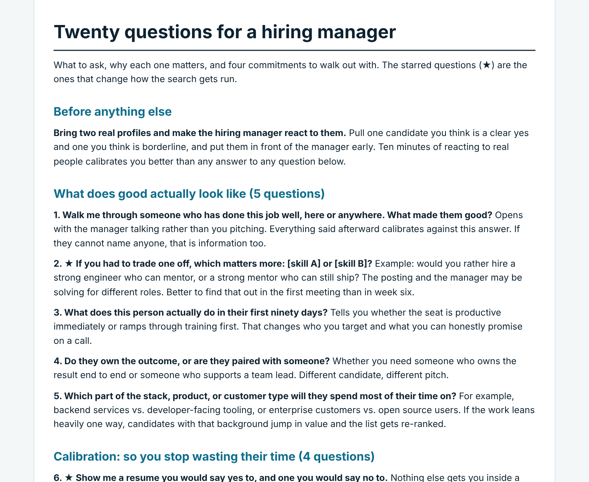

# Recruiter Intake Playbook

A practical question set for the first meeting with a hiring manager, and the plan that comes out of it, built from 15+ years of full-cycle technical recruiting.

## What is in here

- [`intake-questions.md`](intake-questions.md): twenty intake questions in five groups, with a short note on why each one matters. Starred questions are the ones that change how the search gets run.
- Four commitments to ask for before you leave the meeting (48 hour feedback, standing interview slots, a named panel, and a written approval ceiling).
- [`hiring-plan-template.md`](hiring-plan-template.md): the one-page plan you send back within 24 hours, covering success profile, constraints, sourcing, pipeline targets, timeline, risks and cadence.
- [`example-hiring-plan.md`](example-hiring-plan.md): the template filled in for a fictional company and role, so you can see it end to end.
- [`pipeline-math.md`](pipeline-math.md): how to work backward from one hire to outreach volume and a realistic timeline.
- [`interview-scorecard.md`](interview-scorecard.md): a scorecard built from the intake, so every interviewer rates the same competencies.
- [`first-30-days-checklist.md`](first-30-days-checklist.md): week-by-week checklist for the first month of the search.

Examples lean toward engineering and developer-tools roles. Swap in your own.

## How to use it

1. Bring two real candidate profiles, one clear yes and one borderline, and have the hiring manager react to them early.
2. Work through the questions in order, skipping any you already have answers to.
3. Close by asking for the four commitments.
4. Within 24 hours, send the hiring plan and ask the manager to correct it. Review the pipeline numbers against it every week.

## Related

- [`comp-gap-playbook`](https://github.com/micheleburns74-prog/comp-gap-playbook): what to do when the approved pay band doesn't match the job description.

## About

Written by Michele Burns, senior technical recruiter. This is a general template. It contains no employer, candidate, or compensation data, and the example plan is fictional.
